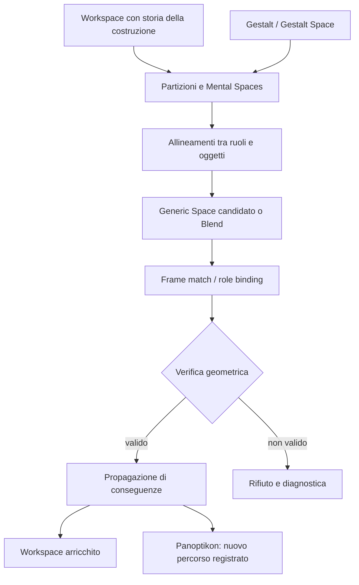

# Merovingio / Panoptikon
## Fondamenti del sistema teorico, obiettivi espliciti e primo protocollo sperimentale

**Versione:** 0.2 — 11 ottobre 2026  
**Stato:** specifica concettuale e di ricerca; **non** attestazione di un'implementazione già funzionante  
**Caso studio iniziale:** *Elementi* di Euclide, Libro I: proposizioni 4, 8, 9 e 10, con I.11 come possibile test successivo. **Nuova priorità v0.2:** pianificazione dimostrativa tramite costruzioni-ponte candidate, oltre al riconoscimento di Frame già presenti.

> **Tesi di progetto.** Una dimostrazione geometrica non è soltanto una catena di proposizioni: è una navigazione in un ambiente cognitivo di figure, partizioni, relazioni e costruzioni. Il Merovingio vuole rappresentare questo ambiente, imparare a riconoscere e re-instanziare strutture dimostrative già acquisite in workspace diversi e verificare rigorosamente le conseguenze.

---

## 1. Perché costruire il Merovingio

### Problema

Un theorem prover tradizionale opera principalmente su formule e regole. La geometria euclidea però offre anche un altro livello: **la costruzione rende disponibili nuove configurazioni**; lo stesso segmento può fungere da bisettrice, lato comune, asse, trasversale, elemento che separa regioni, oppure collegamento tra figure costruite in tempi diversi. Una proposizione già provata diventa poi uno *schema riutilizzabile* all'interno di costruzioni successive.

Il progetto non assume che questa prospettiva sia già una teoria cognitiva empiricamente validata. La propone come ipotesi di architettura computazionale, da testare su esempi controllati e confrontare con baseline più semplici.

### Obiettivi espliciti

1. **Rappresentazione:** codificare una costruzione geometrica senza ridurla a un'immagine raster o a un mero elenco di teoremi: disposizione qualitativa, provenienza, ordine di generazione, oggetti condivisi, multiple interpretazioni e relazioni verificate.
2. **Riconoscimento:** identificare quando una proposizione/Frame già acquisita è applicabile a un workspace nuovo.
3. **Re-instanziazione:** produrre un binding **globalmente coerente** dei ruoli astratti del Frame su oggetti e relazioni del workspace.
4. **Verifica:** certificare mediante regole geometriche deterministiche che le premesse sono davvero soddisfatte; il giudizio probabilistico non costituisce una prova.
5. **Propagazione:** trasferire le conseguenze certificate nel workspace e aggiornare interpretazioni e mental spaces con una provenienza ricostruibile.
6. **Generalizzazione:** riprodurre questo ciclo in workspace non visti, distinguendo vera analogia strutturale dal semplice ricordo della figura o del nome della proposizione.
7. **Interpretabilità:** mostrare quale oggetto ha indotto una partizione, quale mental space ha realizzato un ruolo, perché un Frame è stato scelto e quale passaggio è stato verificato.
8. **Scoperta futura:** esplorare se confronti tra molte istanze possono suggerire nuovi Generic Spaces, macro-Gestalten e costruzioni utili, senza promuovere automaticamente congetture a teoremi.
9. **Constructive proof planning (priorità v0.2):** scegliere una costruzione-ponte candidata prima che esista, motivandola con i Mental Spaces/Generic Spaces che connetterà e il Frame che potrebbe completare.
10. **Ranking congiunto:** valutare `Frame + Bridge + Role Map` anziché ottimizzare selezione della proposizione e assegnazione dei ruoli in modo indipendente.

### Il successo minimo della v0

Il benchmark ha ora **due fasi distinte**, entrambe necessarie. **Fase A, re-instanziazione:** dato I.10 con la bisettrice già costruita, selezionare I.4, realizzare i ruoli e verificare `AD = DB`. **Fase B, pianificazione (nuova):** dato il segmento `AB` e l’equilatero `ABC`, ma **prima** di costruire la bisettrice, proporre il bridge `C → D∈AB` come bisettrice da I.9, spiegando che collega una partizione angolare a quella metrica e rende possibile I.4. Non è ammesso usare `AD=DB` o la bisettrice già tracciata come premessa nascosta nella fase B.

---

## 2. Ontologia: che cosa rappresentiamo

I termini seguenti sono **definizioni operative del progetto**, non un'affermazione che corrispondano senza residui alle definizioni storiche o a quelle della teoria contemporanea del conceptual blending.

| Entità | Definizione operativa | Esempio |
|---|---|---|
| **Gestalt** | Nucleo concettuale-percettivo, inizialmente aperto e non completamente esplicitato, che rende alcuni raggruppamenti e *vital relations* intuitivamente disponibili | triangolo; opposizione; simmetria; divisione |
| **Gestalt Space** | Conoscenza strutturata e progressivamente arricchita di una Gestalt: componenti, vincoli, trasformazioni, leggi, percorsi verificati | triangolo con opposizione lato-angolo, LAL, LLL, ordini |
| **Mental Space** | Raggruppamento/partizione locale di oggetti e relazioni, indotto da una Gestalt, da un elemento costruttivo, da un frame, da un goal o dal workspace | lato sinistro/destro della bisettrice; spazio dei segmenti; spazio degli angoli |
| **Generic Space** | Schema relazionale condiviso o estratto dall'allineamento di più mental spaces/frames, con origine e status epistemico espliciti | due triangoli con lato condiviso e coppie di lati corrispondenti; trasferimento di divisione angolare in metrica |
| **Frame astratto** | Schema applicativo con ruoli tipizzati, vincoli di coerenza e conseguenze; può derivare da una proposizione dimostrata | I.4 = due lati e angolo compreso in corrispondenza |
| **Frame istanziato** | Un Frame astratto con una mappa di ruoli su oggetti concreti di un workspace e con premesse verificabili | I.4 applicato ai triangoli ACD e BCD in I.10 |
| **Workspace** | Stato locale e temporale della costruzione: geometria qualitativa, elementi, relazioni, provenance, gruppi, candidati, conclusioni | la costruzione progressiva di I.9 oppure I.10 |
| **Panoptikon** | Atlante complessivo di workspace, Gestalt Spaces, Frames, Generic Spaces, genealogie, analogie, percorsi e recontestualizzazioni | il riuso di I.8 in I.9 e di I.9/I.4 in I.10 |

**Nuova entità operativa (v0.2):** il `ConstructionBridgeCandidate` è una **operazione ipotizzata**, non ancora un oggetto esistente. Specifica endpoint o luogo geometrico da connettere, fonte del suggerimento, spazi che metterebbe in relazione, Frame che potrebbe completare e condizioni di realizzabilità. Il sistema lo promuove da `candidate` a `constructed` solo eseguendo una costruzione ammessa; le proprietà previste restano ipotesi fino a prova.

**Precauzione terminologica:** dire che un Generic Space *emerge* da due frame non significa che tutte le loro relazioni siano automaticamente equivalenti. Serve una mappa di corrispondenza, eventualmente parziale, e un controllo di consistenza. Un Mental Space non deve essere una partizione disgiunta: **oggetti-ponte** possono appartenere a più spazi.

### Processo cognitivo ipotizzato



Un Frame può anche indurre nuove partizioni; non esiste un unico ordine obbligato. La sequenza sopra è una pipeline iniziale di lavoro, non un vincolo ontologico universale.

---

## 3. Workspace: sintassi costruttiva distinta dalla semantica geometrica

### 3.1 Construction skeleton (`K`)

Lo scheletro qualitativo deve conservare come minime primitive:

- `incident(point, carrier)` — appartenenza a retta, raggio o segmento;
- `between(A, O, B)` — ordinamento strettamente interno su una retta;
- `collinear(A, O, B)` e `line_order` — allineamento con sequenza;
- `orient(A, B, C)` — posizione orientata (sinistra/destra/collineare);
- `cyclic_order(O, [r1, r2, ...])` — ordine dei raggi attorno a un vertice;
- `constructed_from(output, operation, inputs, step)` — provenienza e dipendenze.

Occorre distinguere `Line(A,B)`, `Ray(A,B)`, `Segment(A,B)` e `Angle(ray1,ray2)`; essere collineari non vuol dire essere uguali come segmenti. Coordinate numeriche eventuali servono per il rendering e per controlli, **non come unica fonte delle relazioni qualitative**.

### 3.2 Relazioni geometriche (`R`)

`equal_length`, `equal_angle`, `parallel`, `perpendicular`, `angle_bisector`, `triangle_congruence`, `midpoint`, `opposite_side_angle` ecc. Ogni relazione ha uno **stato epistemico**:

- `given` / `constructed`: garantita dalle premesse o da una costruzione ammessa;
- `verified`: dedotta mediante una regola verificata;
- `candidate`: ipotizzata, ancora non verificata;
- `latent`: possibile interpretazione utile, **non** un fatto geometrico acquisito;
- `rejected`: proposta controllata e risultata incompatibile.

È vietato usare un predicato `latent` come premessa certificata in `VERIFY`.

### 3.3 Interpretazioni multiple (`rho`)

A ogni oggetto possono corrispondere molte interpretazioni, ciascuna con:

`role, mental_space, source_frame, status, generation_step, evidence`.

Uno stesso segmento può essere `shared_side` già al passo 4 e `angle_bisector` solo dopo l'applicazione di una proposizione. Non tutte le etichette sono indipendenti né egualmente informate.

### 3.4 Elementi generatori e nuovi raggruppamenti

Una bisettrice, trasversale o intersezione può produrre *mental spaces* senza che questi siano già Gestalten stabili. Si registra:

`generator -> partition_rule -> member_spaces -> correspondence_candidates -> generic_spaces`.

Esempio: un segmento `CO` dal vertice `C` a `O` sulla base `AB` delimita le due regioni triangolari `ACO` e `BCO`. `CO` resta condiviso; `O` è nodo dell'intersezione con la base. Un *Generic Space* candidato può collegare `AC ↔ BC`, `AO ↔ OB`, `CO ↔ CO`, ma deve distinguere **corrispondenza strutturale** da **uguaglianza già provata**.

### 3.5 Salience Field

Salienza dinamica e relativa al goal:

\[
S_t(x\mid W,Q,P)=f(\text{ruoli verificati},\text{numero e diversità di spazi collegati},\text{generatività},\text{utilità storica},\text{goal}).
\]

Non attribuire alto punteggio solo perché un segmento ha molte etichette. Importano anche gli **effetti controfattuali** (quante connessioni si perdono togliendolo), la capacità di ridurre rami di ricerca e il fatto che un ruolo sia effettivo invece di soltanto ipotetico. Per la v0 basta un punteggio euristico trasparente, non un modello allenato end-to-end.

### 3.6 Salienza prospettica delle costruzioni non ancora effettuate

Fino alla v0.1 stimavamo la salienza di oggetti già presenti. La v0.2 distingue:

- `ObjectSalience(x | W,Q)`: quanto è utile un oggetto esistente per il goal;
- `BridgePotential(b | W,Q,F)`: quanto può essere promettente **una costruzione ancora non eseguita** `b` per connettere mental spaces/Generic Spaces pertinenti e completare il Frame `F`.

Esempio in I.10: prima della bisettrice, `CD` **non esiste ancora**; è solo il piano di tracciare da `C` la bisettrice di `∠ACB`, fino all'intersezione `D` con `AB`. Questa operazione collega `MS_angular_partition` e `MS_segment_partition`, produce due triangoli con lato comune, e completa l'angolo incluso richiesto da LAL. La costruzione **non implica di per sé** `AD=DB`: quella relazione deriva solo dopo I.4 verificato.

Proponiamo come ipotesi di ranking, non come legge cognitiva validata:

\[
V(F,b,\rho\mid W,Q)=f(\text{goal relevance},\text{bridge potential},\text{missing-slot cost},\text{proof dependencies},\text{uncertainty}).
\]

Il programma genera candidati tipizzati e calcola i vincoli rigidi; Jev rankizza le **triple complete** `(frame, bridge, role_mapping)` e il verifier certifica il piano eseguito. Un grande numero di ruoli non garantisce utilità: la scelta deve essere condizionata al goal.

---

## 4. Euclide I.9: da un angolo a una bisettrice attraverso I.8

### 4.1 Problema ed esattezza storica

**Obiettivo:** bisecare l'angolo dato `BAC`.

**Notazione standard della costruzione:**

1. Scegliere `D` su `AB`.
2. Su `AC` scegliere `E` in modo che **AD = AE** (I.3).
3. Congiungere `D` ed `E`.
4. Costruire un triangolo equilatero **DEF** sulla base `DE`, scegliendo `F` sul lato opposto ad `A` rispetto alla retta `DE` (I.1).
5. Congiungere `A` ed `F`.

Schema topologico *illustrativo*, non in scala:

```text
               A
              / \
             /   \
            D-----E       D∈AB, E∈AC, AD=AE
           / \   / \
          /   \ /   \
         B     F     C    DEF equilatero sul lato lontano da A

            A——F è il segmento che biseca ∠BAC
```

La figura sopra segnala gli oggetti ma non rappresenta proporzioni o prolungamenti con precisione; il dato verificabile è la lista di incidenza/ordine e le condizioni sulla scelta di `F`.

### 4.2 Dimostrazione rigorosa e Frame

Consideriamo i **due triangoli ADF e AEF**:

- `AD = AE` (costruzione sui due raggi);
- `DF = EF` (equilatero `DEF`);
- `AF = AF` (identità del segmento condiviso).

Si soddisfa **I.8 = LLL / SSS**, non I.4:

\[
(AD=AE)\land(DF=EF)\land(AF=AF)
\xRightarrow{\mathrm{I.8}}
\angle DAF=\angle FAE.
\]

Poiché `AD` e `AB` sono lo stesso raggio da `A`, così come `AE` e `AC`, la retta `AF` biseca `∠BAC`.

**Errore da evitare:** I.9 non usa I.4/LAL nella dimostrazione principale. Non richiede il punto di intersezione fra `AF` e `DE`. Se aggiungiamo un punto `O = AF ∩ DE` per l'analisi cognitiva o il rendering, è un **oggetto esteso del nostro workspace**, non un passo dell'originale I.9. Non dobbiamo trattarlo come punto medio o piede della perpendicolare senza una dimostrazione ulteriore.

### 4.3 Lettura nel Merovingio

**Frame iniziali:** `F_given_angle(BAC)`; `F_equal_ray_marks(AD,AE)`; `F_aux_equilateral(DEF)`.

**Ordine di generazione:** angolo → due segmenti su raggi → segmento di congiunzione `DE` → equilatero `DEF` → nuovo segmento ponte `AF` → coppia triangolare `(ADF,AEF)` → instanziazione di I.8 → divisione angolare.

**Oggetto ponte `AF`:** congiunge il vertice del problema originario `A` al vertice dell'ausiliario `F`; è lato comune dei due triangoli finali; può diventare un asse percettivo. È corretto chiamarlo `bisector` **solo dopo** la prova, salvo usarlo prima come `bisector_candidate`.

**Mental Spaces indotti:** `MS_left_triangle(ADF)`, `MS_right_triangle(AEF)`, inizialmente generati dal collegamento `AF`; il segmento appartiene a entrambi.

**Generic Spaces candidati e loro origine:**

| Generic Space | Origine registrata | Evidenza / status |
|---|---|---|
| `paired_triangles_shared_bridge` | `AF` collega frame angolo ed equilatero | struttura/ruolo verificabile |
| `LLL_role_correspondence` | confronto dei frame `ADF`, `AEF` | tre uguaglianze di lati verificate |
| `metric_to_angular_partition` | instanza I.8 in I.9 | conversione certificata in questo workspace |
| `intersection_reuse` | eventuale `O` aggiunto a posteriori | latente; non necessario alla prova |

**Lettura concettuale:** non è una generica legge per cui “lati uguali generano sempre angoli divisi”. È una *specifica costruzione* in cui due vincoli metrici introdotti separatamente più il lato condiviso completano un Frame LLL e producono la bisezione cercata.

---

## 5. Euclide I.10: da bisettrice a punto medio attraverso I.4

### 5.1 Problema e costruzione

**Obiettivo:** dividere un segmento dato `AB` in due parti uguali.

1. Costruire il triangolo equilatero **ABC** sulla base `AB` (I.1).
2. Bisecare `∠ACB` con la semiretta `CD` costruita usando **I.9**.
3. `D` è il punto in cui la bisettrice `CD` incontra `AB` (nel suo interno).

Schema orientativo:

```text
                   C
                  /|\
                 / | \
                /  |  \
               /   |   \
              A----D----B

      triangoli: ACD (sinistra), BCD (destra)
      D si trova su AB e C–D è comune ai due
```

### 5.2 Passaggio dimostrativo

Nel Frame `(ACD, BCD)`:

- **AC = BC** perché `ABC` è equilatero;
- **∠ACD = ∠DCB** grazie alla costruzione della bisettrice mediante I.9;
- **CD = CD** poiché è lo stesso segmento per entrambi i triangoli.

Gli angoli uguali sono *compresi* fra le coppie di lati corrispondenti. Si istanzia quindi **I.4 = LAL / SAS**:

\[
(AC=BC)\land(\angle ACD=\angle DCB)\land(CD=CD)
\xRightarrow{\mathrm{I.4}}
AD=DB.
\]

Essendo `A-D-B`, `D` è punto medio di `AB`. La perpendicolarità `CD ⟂ AB` può essere ricavata *successivamente* combinando l'uguaglianza degli angoli adiacenti in `D` con il fatto che formano un angolo piatto, ma **non è premessa della prova di I.10**.

### 5.3 Lettura cognitiva dei ruoli

- `AB`: segmento da dividere; base dell'equilatero; carrier dei futuri sottosegmenti `AD,DB`.
- `C`: vertice dell'equilatero; sorgente dell'angolo bisecato; origine del bridge.
- `CD`: bisettrice di `∠ACB`; lato comune dei triangoli `ACD`/`BCD`; generatore della partizione sinistra/destra; ponte tra il dominio dell'angolo e quello del segmento.
- `D`: intersezione costruita di `CD` con `AB`; nodo di partizione; **diventa** midpoint di `AB` solo dopo `VERIFY+PROPAGATE`.

**Mental Spaces:** `MS_equilateral(ABC)`, `MS_angular_bisection(CD)`, `MS_left(ACD)`, `MS_right(BCD)`, `MS_segment_partition(AD,DB)`.

**Generic Spaces:**

| Generic Space | Generatore / provenienza | Utilità |
|---|---|---|
| `left_right_pair_correspondence` | partizione indotta da `CD`; `AC ↔ BC`, `AD ↔ DB`, `CD ↔ CD` | candidati al binding di LAL |
| `side_opposite_angle` | topologia interna dei due triangoli | consente successive analogie tra lati e angoli opposti, senza asserire uguaglianze premature |
| `angular_to_metric_division` | I.9 fornisce bisettrice; I.4 istanziato verifica `AD=DB` | trasduzione verificata, contestuale |
| `intersection_role_accumulation` | `D` su `CD` e `AB` | registra il passaggio `intersection` → `midpoint` dopo la prova |

### 5.4 Perché I.10 è una conversione di Frame

Il Frame **astratto** di I.4 è `L1 + ANGLE_INCLUDED + L2`. Non contiene punti etichettati `A, B, C, D`.

Nel workspace di I.10 si applica la mappa:

```yaml
frame_template: EUCLID_I_4_LAL
triangle_1: [A, C, D]
triangle_2: [B, C, D]
vertex_correspondence: {A: B, C: C, D: D}
role_bindings:
  equal_side_1: {left: AC, right: BC, source: equilateral_ABC}
  included_angle: {left: ACD, right: DCB, source: bisector_CD_via_I9}
  equal_side_2: {left: CD, right: CD, source: shared_carrier_identity}
result_if_verified:
  - {equal_length: [AD, DB]}
```

Questa **non è semplicemente una classificazione ex post**: la costruzione ha reso contemporaneamente disponibili tre ruoli provenienti da fonti distinte. Il sistema deve riconoscerli e verificarne la compatibilità sotto una **singola mappa di corrispondenza dei vertici**. Completare i tre slot indipendentemente senza controllare l'angolo compreso darebbe falsi positivi.

### 5.4bis Decisione *prima* della bisettrice: collegare spazi concettuali

Con l'equilatero `ABC` già costruito, il goal `AD=DB` è ancora irraggiunto e `D` **non è ancora definito**. Esistono invece `C`, `AB` e l'angolo `∠ACB`. Il sistema può proporre una nuova costruzione:

`b = bisect_angle(C, ACB) → ray_C; intersect(ray_C, segment_AB) → D`.

La motivazione cognitiva è più ricca di «aggiungere una linea»:

1. `MS_angle(C)` contiene l'angolo che può essere suddiviso in due parti uguali mediante I.9.
2. `MS_segment(AB)` contiene il segmento da dividere in sottosegmenti `AD`, `DB`.
3. Il futuro `CD` è un **carrier condiviso** tra i due triangoli che saranno generati; il futuro `D` è un nodo d'intersezione/partizione, non ancora un punto medio.
4. Il nuovo workspace **potrebbe** completare il Frame I.4 poiché `AC=BC`, `CD=CD` e gli angoli compresi diventerebbero uguali per la bisettrice.
5. Solo *dopo* costruzione, verifica di LAL e propagazione, `AD=DB` diventa vero certificato e nasce il ruolo `midpoint(D,AB)`.

La **struttura genericamente cercata** è `angle-partition ↔ segment-partition`: non è una regola universale «dividi angolo e automaticamente dividi base», ma un **piano condizionato** alle uguaglianze dell'equilatero e al Frame LAL. Questa distinzione protegge il reasoner da analogie false.

### 5.5 Il rapporto I.9 → I.10

| | I.9 | I.10 |
|---|---|---|
| Problema iniziale | dividere un angolo | dividere un segmento |
| Costruzione ausiliaria | equilatero su `DE` | equilatero su `AB`, bisettrice ottenuta da I.9 |
| Frame di congruenza decisivo | **I.8 — LLL** | **I.4 — LAL** |
| Segmento-ponte | `AF` | `CD` |
| Risultato | due angoli uguali | due sottosegmenti uguali |
| Relazione panoptica | costruzione metrica che realizza una divisione angolare | divisione angolare che rende possibile una divisione metrica |

**Insight circoscritto:** I.9 e I.10 suggeriscono una *famiglia* di trasferimenti fra mental spaces metrici e angolari. Non costituiscono, senza ulteriori premesse, un teorema generale di equivalenza fra qualsiasi divisione metrica e qualsiasi divisione angolare.

---

## 6. Primo protocollo di reasoning: SELECT → BIND → VERIFY → PROPAGATE

### SELECT

Input: workspace parziale, goal, registro dei Frame e relazioni già certificate. Output: graduatoria di Frame candidati (`I.4`, `I.8`, `none`, …). Proporre più candidati è utile: il migliore score non basta a provare applicabilità.

### BIND

Prima enumerare **candidati strutturalmente ammissibili** via vincoli deterministici (tipi di oggetti, numero di vertici, mappa biunivoca coerente, inclusione dell'angolo, lato comune ecc.); poi usare Jev per **classificare/rankizzare binding completi**, non selezionare ciascun ruolo isolatamente ignorando le dipendenze.

### VERIFY

Verificatore simbolico controlla geometria combinatoria, provenienza e tutte le premesse. Non può utilizzare `candidate`, `latent` o relazioni conseguenti alla stessa applicazione del Frame (circular reasoning). Il verificatore deve mantenere un grafo aciclico di dipendenze e rifiutare una prova che richiede se stessa.

### PROPAGATE

Aggiunge solo conseguenze dimostrate (qui `AD = DB`) con `source_proposition=I.4`, `frame_instance`, `role_binding_id`, `proof_dependencies`. Aggiorna interpretazioni come `D=midpoint(AB)`, può proporre altri Generic Spaces e riaprire workspace vecchi per nuovi percorsi (*back-propagation*) senza dichiarare automaticamente vere le analogie.

### PRIORITIZE (opzionale nella v0)

Dopo la verifica, scegliere quali conseguenze o quali punti di partizione esaminare prima, con punteggi probabilistici e benchmark di utilità. **La probabilità è una priorità di ricerca, non un certificato di verità.**

---

## 7. Costruzioni-ponte: pianificazione dimostrativa, non solo reframing

### 7.1 Due compiti di reasoning da non confondere

**Riconoscimento (post-construction):** la bisettrice è già presente. `SELECT(I.4) → BIND(ACD,BCD) → VERIFY → PROPAGATE` verifica il riuso del Frame.

**Pianificazione (pre-construction):** la bisettrice non è stata tracciata. Il sistema deve scegliere **quale modifica del workspace** renderà possibile una dimostrazione. La sua unità di scelta è `Plan = (Frame F, ConstructionBridgeCandidate b, proposed RoleMap ρ, target Q)`.

La decisione desiderata è dunque:

\[
(F^*,b^*,\rho^*)=\operatorname{argmax}_{(F,b,\rho)\in\mathcal A(W,Q)} V(F,b,\rho\mid W,Q,\mathcal P),
\]

dove `𝒜` contiene **solo piani tipizzati** generati da un modulo simbolico, con precondizioni controllabili. Jev può scegliere fra opzioni discretizzate; non deve inventare coordinate arbitrarie o affermare che le conseguenze future siano già vere. In v0.2 il massimo è un **ranking euristico**, non una distribuzione probabilistica già calibrata.

### 7.2 Il caso I.10, suddiviso in stati epistemici

| Stato | Costruzione disponibile | Fatti utilizzabili | Fatti NON disponibili |
|---|---|---|---|
| `W0` | segmento `AB` | dato `AB`; goal bisezione | `C`, bisettrice, `D`, uguaglianze di triangoli |
| `W1` | triangolo equilatero `ABC` su `AB` | `AC=BC`, `AC=AB` | `CD`, `D`, `∠ACD=∠DCB`, `AD=DB` |
| `W2` | applicazione I.9: bisettrice `CD` che incontra `AB` in `D` | uguaglianza degli angoli compresi e `CD=CD`, insieme ai precedenti | `AD=DB` non ancora provato |
| `W3` | Frame I.4 verificato fra `ACD` e `BCD` | congruenza, `AD=DB`; ruolo `midpoint` certificato | nessuna ulteriore proprietà senza prova |

**La scelta anticipatoria avviene in `W1`.** Il sistema non deve vedere il risultato `W3` e poi retrodatare le sue proprietà.

### 7.3 Confronto di piani candidati

- **Piano A — I.4/LAL + bisettrice da C a AB:** `AC=BC` è già provato; la nuova bisettrice renderebbe uguali gli angoli compresi; `CD` diventerebbe lato comune. La conclusione `AD=DB` è un output valido di I.4.
- **Piano B — I.8/LLL sui triangoli ACD e BCD senza nuove premesse:** richiederebbe `AD=DB` per dimostrare `AD=DB`; **rigettare per circolarità**, non semplicemente assegnare uno score basso.
- **Piano C — scegliere un punto arbitrario D su AB e congiungerlo a C:** produce due triangoli e un lato comune, ma **non** la necessaria uguaglianza degli angoli compresi; il Frame I.4 resta incompleto.
- **Piano D — usare I.26/ALA:** non appartiene al registro di proposizioni disponibili in I.10 secondo la sequenza euclidea; escluso dal benchmark storico. Potrà essere ammesso in un benchmark separato sul Panoptikon maturo.

I piani non scelti da Euclide **non sono automaticamente falsi**: etichettarli come negativi richiede dimostrare una violazione oppure qualificare il giudizio come `less_promising`, non `invalid`.

### 7.4 Schema dati minimo del candidato ponte

```yaml
candidate_plan_id: I10_LAL_ANGLE_TO_SEGMENT_BRIDGE
at_state: W1
status: candidate
frame_template: EUCLID_I_4_LAL
goal:
  predicate: equal_length
  args: [AD, DB]              # goal, NON fatto verificato
bridge:
  operation: angle_bisector_then_intersection
  inputs: [vertex_C, angle_ACB, segment_AB]
  proposed_outputs: [ray_CD, point_D, segment_CD]
  source_generic_space: equal_angle_partition
  target_generic_space: equal_segment_partition
  potential_mental_spaces: [triangle_ACD, triangle_BCD]
role_mapping_after_bridge:
  equal_side_1: [AC, BC]      # già verificato in W1
  included_angle: [ACD, DCB] # da provare/costruire applicando I.9
  equal_side_2: [CD, CD]      # identità dopo la costruzione
prerequisites:
  - I.1_available
  - I.9_available
  - I.4_available
predicted_consequence: [equal_length, AD, DB]
verification_status: pending
```

`predicted_consequence` è un **obiettivo condizionale**, non una relazione utilizzabile dal verificatore prima della prova. `proposed_outputs` non devono entrare nel set degli oggetti esistenti prima che la costruzione sia eseguita.

### 7.5 Ruoli di Jev e divisione dei compiti

1. **Candidate generator (deterministico):** propone Frame e costruzioni ammissibili, elenca i nuovi oggetti ipotetici, evita binding tipologicamente incoerenti e cicli immediati.
2. **Jev SELECT-PLAN (probabilistico):** rankizza `Plan A`, `Plan B`, `Plan C`, … già codificati. Ogni opzione esplicita Frame, bridge, role map provvisoria, relazione con il goal e costo previsto.
3. **Construction engine (deterministico):** applica l'operazione lecita scelta e produce `W2`, con incidenza, ordine e provenance.
4. **Verifier (deterministico):** controlla le premesse del Frame sullo stato aggiornato. In caso di fallimento propone backtracking, non inventa un successo.
5. **PROPAGATE (deterministico):** registra le conseguenze certificate nel workspace e Panoptikon.
6. **Jev PRIORITIZE (probabilistico, fase seguente):** sceglie altri bridge candidati, Generic Spaces e obiettivi secondari da investigare.

Le domande Jev sono **indipendenti sullo stesso state**: la coerenza fra Frame e assegnazioni dei ruoli non è garantita da domande parallele. Per il planning iniziale è preferibile **una `choice` fra piani completi coerentemente proposti**. Un secondo passaggio può rankizzare binding completi generati dall'engine.

### 7.6 Esperimento minimo ed ablation

**Test di pianificazione I.10:** si presenta solo `W1`, il registro `I.4, I.8, I.9` e il goal. Il candidato vincente dovrebbe proporre una bisettrice dell'angolo in C che incontri AB, motivata da `BridgePotential` e completamento LAL; dopo la verifica simbolica deve essere possibile provare `AD=DB`.

Confrontare le baseline a parità di generatore/verificatore:

- `B0`: enumerazione deterministica di tutti i piani validi;
- `B1`: ranking con soli slot già soddisfatti;
- `B2`: ranking con goal e costo di completamento dei role;
- `B3`: ranking con mental spaces e Generic Spaces, ma senza valore ponte;
- `B4`: ranking Jev con **BridgePotential + Generic Space + provenance**.

**Metriche:** top-k recall del piano produttivo; tasso di scelta di piani circolari; costruzioni e nodi esplorati; chiamate/token e latenza; percentuale di goal effettivamente provati; transfer su varianti strutturalmente equivalenti con punti rinominati, figure ruotate/riflesse e provenienze alternative. Fare split per **famiglia di costruzioni**, non solo per immagini, per evitare leakage tra varianti dello stesso esempio.

**Soglia metodologica:** con un solo I.10 non si può affermare che Jev abbia imparato il bridge planning. Il primo caso è un *smoke test*; servono decine di esempi e holdout realmente nuovi prima di attribuire valore causale a Generic Spaces/BridgePotential.

---

## 8. Jev: perché può essere utile, e che cosa consente davvero l'API

### 8.1 La decisione giusta da delegare

Jev è un modello *System One* di TypeSafe AI pensato per decisioni veloci tipizzate su uno `state`, non per scrivere dimostrazioni. L'articolo di presentazione descrive **output probabilistici strutturati, campionamento parallelo** e alta efficienza su compiti a scelta delimitata. Queste sono dichiarazioni del produttore; devono essere verificate sulle nostre task geometriche. Nella nostra architettura Jev fornisce un **Impetus probabilistico**: quale Frame, quale binding, quale nuovo raggruppamento, quale conseguenza conviene esplorare. La correttezza è compito del verifier.

### 8.2 Fatti API verificati nella documentazione ufficiale al 2026-10-11

- Endpoint: `POST https://api.typesafe.ai/v1/systemone`, autenticazione `Authorization: Bearer <API_KEY>`.
- Body: `model`, `state` (stringa, oggetto JSON o array), `questions` (mappa di domande).
- Modello di riferimento: `jev-1.13.0` (oppure alias mobile `jev-latest`). Conviene *pin* della versione nei benchmark.
- Primitive: **`choice`** (opzioni predefinite, fino a 255; ritorna distribuzione + scelta + confidence), **`score`** (rubrica ordinata 2–10 livelli, con distribuzione/confidence), **`noul`** (probabilità sì/no 0–1).
- Più domande possono condividere lo stesso `state` in una chiamata, ma **sono valutate indipendentemente**: non si deve presupporre che il modello coordini internamente i binding.
- Input **testuale/strutturato, non immagini**; immagini geometriche vanno prima interpretate o convertite in struttura.
- Limiti dichiarati: 64k token per richiesta; 32k per `state` più la domanda più lunga; prezzo dichiarato $0.042 per milione di token di input, output gratuito, soggetto a variazioni.
- **Nessun fine-tuning/LoRA per account** secondo la documentazione ufficiale: il dataset servirà ad annotazioni, valutazioni, calibrazione, progettazione delle domande e — eventualmente — a un modello locale separato, non a supporre addestramento dei pesi di Jev.
- Errori documentati: 401, 422, 429, 529; usare retry/backoff su overload/rate limit e fallback deterministico se non disponibile.

### 8.3 Esempio di richiesta compatibile con l'API

Le opzioni e i dati qui sotto sono **esempi di progetto**, non risultati restituiti dal servizio.

```json
{
  "model": "jev-1.13.0",
  "state": {
    "workspace": "EUCLID_I10",
    "goal": "prove AD equals DB",
    "verified_relations": [
      "AC=BC (equilateral ABC)",
      "angle ACD=angle DCB (bisector CD)",
      "CD=CD (shared segment)"
    ],
    "candidate_triangle_pair": ["ACD", "BCD"]
  },
  "questions": {
    "frame_selection": {
      "type": "choice",
      "instructions": "Which known triangle-congruence frame is the most promising next candidate for these verified relations? Only rank candidates; do not assert a proof.",
      "criteria": {
        "I4_SAS": "Two side pairs equal and the included corresponding angle equal",
        "I8_SSS": "Three corresponding side pairs equal",
        "NONE": "Neither frame is supported well enough by current evidence"
      }
    },
    "can_explore_axis": {
      "type": "noul",
      "instructions": "Is the shared segment CD a promising focus for identifying two corresponding triangle regions?"
    }
  }
}
```

**Binding di fase 2:** il programma costruisce una lista finita di *role maps complete* con nomi come `binding_01` e `binding_02`. Jev riceve un'altra `choice` su quelle mappe, con possibilità `NONE`. Il verifier esamina i candidati in ordine. Non passare al verifier una stringa arbitraria generata dal modello: Jev non produce stringhe libere e il catalogo dei binding è costruito dal programma.

### 8.4 Politiche di affidabilità

Registrare per ogni decisione: versione del modello, request-id, hash dello stato, elenco opzioni, risposta, distribuzione, confidence, esito del verifier, tentativi successivi, costi/latency reali. Distinguere **confidence di una scelta** da **probabilità di verità di una proposizione** e dalla **validità matematica**. Misurare la calibrazione specifica sul dataset geometrico; la calibrazione dichiarata dal produttore non è garanzia sul nostro dominio.

Usare fallback a enumerazione completa e verifica dei binding quando Jev non è accessibile, ha bassa confidenza o seleziona soltanto alternative invalide. La baseline deterministica è indispensabile per capire il valore aggiunto di Jev.

---

## 9. Training e valutazione: che cosa significa qui 'imparare'

Le prove di Euclide forniscono **tracce positive** di scelte di costruzione, dipendenze e riuso di proposizioni, non automaticamente l'unico percorso valido. Non considerare ogni mossa non scelta da Euclide una mossa sbagliata: possono esistere dimostrazioni alternative.

### Dati annotati

Ogni esempio contiene: `initial_workspace`, `construction_events`, `mental_spaces`, `role_interpretations`, `generic_space_origins`, `candidate_frames`, `gold_binding`, `proof_dependencies`, `verified_consequences`, `latent_hypotheses`, `goal`. La prova finale non deve essere inclusa nello `state` di valutazione per non generare **leakage**.

### Hard negatives

- quasi-LAL dove l'angolo uguale **non è quello compreso**;
- lato comune assegnato a vertici incompatibili;
- uguaglianze di angoli visivamente apparenti ma non provate;
- un candidato `midpoint` ancora latente usato erroneamente come premessa;
- coppie di triangoli con corrispondenza scambiata o stesso oggetto nominato due volte in ruoli incompatibili;
- caso corretto geometricamente ma con dependency cycle.

### Benchmark minimo e ablation

**Nuovo requisito v0.2:** oltre ai test post-costruzione qui sotto, valutare i candidati `Frame + Bridge + RoleMap` nella fase **pre-costruzione** (capitolo 7). Il sistema deve saper proporre una costruzione che completi un Frame, senza conoscere o riutilizzare come input la conclusione futura.


1. **I.9:** selezionare I.8 (LLL), bindare `AD↔AE`, `DF↔EF`, `AF↔AF`, verificare uguaglianza degli angoli in A.
2. **I.10:** selezionare I.4 (LAL), bindare `AC↔BC`, `∠ACD↔∠DCB`, `CD↔CD`, verificare `AD=DB`.
3. **Holdout I.11** (solo dopo): usare Frame appresi senza codificare esplicitamente la risposta del caso.
4. **Transfer AXIS/PARALLEL/RADIAL** (fase successiva): passare a I.26 e confrontare casi con geometria ambientale diversa ma ruoli astratti comuni.
5. Confrontare: regole deterministiche sole; Jev solo SELECT; Jev SELECT+BIND; Jev con salience/provenance; Jev senza mental spaces/Generic Spaces; eventuale LLM generalista come ranker a parità di verifier.

**Metriche:** frame recall@k; exact binding accuracy; fraction verified; precision of accepted steps (=1 by costruzione se verifier affidabile); false activation rate; nodes explored; numero di chiamate/token; tempo alla prima prova; nuove prove valide trovate in workspace holdout; generalizzazione sotto rinomina dei punti, rotazione, riflessione e ridisegno senza cambiare vincoli. I numeri-obiettivo saranno fissati prima del test, non dichiarati come risultati ora.

### Milestone e confini della v0

| Milestone | Deliverable | Criterio di uscita |
|---|---|---|
| M0 — ontologia | presente documento e glossario | definizioni non circolari e distinzione tra candidate/verified |
| M1 — dati | I.4, I.8, I.9, I.10 annotati e rivisti | construction provenance e role-map verificabili |
| M2 — motore simbolico minimo | validazione di LAL e LLL, corrispondenze vertici, propagazione | I.9/I.10 rieseguibili senza hard-code della conclusione |
| M3 — euristiche | enumeratore di Frame e binding, salienza trasparente | baseline riproducibile |
| M4 — Jev | SELECT/BIND su insiemi chiusi, logs e fallback | confronto quantitativo con baseline |
| M4b — bridge planning (priorità sperimentale) | stati pre-costruzione, candidati `(Frame, Bridge, RoleMap)`, verifica I.10 da `W1` | scegliere una costruzione produttiva e ottenere la prova senza leakage né scorciatoie codificate a mano |
| M5 — transfer | I.11 e nuovi workspace; poi I.26/AXIS/PARALLEL/RADIAL | generalizzazione misurata, senza leakage |

**Escluso inizialmente:** interpretazione di immagini raw, proof discovery generale, grande corpus automatizzato di tutti gli *Elementi*, ontologia completa dei porismi, apprendimento automatico di nuove primitive non verificabili, training dei pesi di Jev, applicazione a geometrie non euclidee.

---

## 10. Criteri di qualità epistemica del Panoptikon

1. **Non scambiare interpretazione per dimostrazione.** La visibilità di un asse non implica che sia perpendicolare o mediana.
2. **Non scambiare corrispondenza per uguaglianza.** `AC ↔ BC` in una mappa di ruoli non prova da sola `AC = BC`.
3. **Non scambiare riscoperta di una conseguenza già nota per insight.** Una seconda certificazione di congruenza dopo averla già provata può essere utile come indice, ma non è nuova propagazione di conoscenza.
4. **Evitare circolarità.** La dipendenza dei teoremi si controlla a livello di prova e di singola istanza di Frame.
5. **Trattare ogni nuovo Generic Space come ipotesi di astrazione.** Va testato su altre configurazioni per sapere se è veramente trasferibile.
6. **Distinguere propedeutica e novità.** Il linguaggio di mental spaces/Frames è una proposta progettuale ispirata da temi storici e cognitivi, non un'attribuzione letterale a Euclide.
7. **Mantenere l'ordine temporale.** Ciò che diventa noto al passo `t+1` non può essere usato nel ragionamento del passo `t`.

---

## 11. Decisioni aperte e prossima attività

**Decisioni da validare prima di scrivere il codice:**

- Per la v0, quali predicati del construction skeleton ammettono regole di chiusura automatiche? Quali vanno dichiarati esplicitamente?
- Quanto è ricca la corrispondenza dei vertici che un enumeratore può produrre senza combinatoria eccessiva?
- I Generic Spaces sono oggetti espliciti annotati dall'uomo oppure proposte estratte da confronti di Frame? Nella v0: entrambi, con `origin_type` differente.
- Quanto del costo di ricerca diminuisce Jev quando i binding sono già filtrati deterministicamente?
- Come prevenire che la visualizzazione suggerisca uguaglianze inesistenti perché un diagramma è schematico?

**Primo task operativo dopo approvazione del documento:** costruire i quattro record rigorosi `I.4`, `I.8`, `I.9`, `I.10` e il verificatore minimo, aggiungendo due stati di I.10 (`W1` pre-bisettrice e `W2` post-bisettrice) e almeno tre piani-candidati tipizzati con i loro vincoli. Eseguire prima il benchmark di re-instanziazione e quello di costruzione-ponte con la baseline deterministica; poi Jev per ranking congiunto, senza assumere che il solo smoke test dimostri generalizzazione.

---

## Changelog v0.2

- Constructive proof planning e `BridgePotential` come obiettivi di primo piano, distinti dalla re-instanziazione ex post.
- Ranking congiunto `Frame + ConstructionBridgeCandidate + RoleMap` anziché decisioni scollegate.
- Stato I.10 esplicitamente separato in `W0/W1/W2/W3`; eliminazione del rischio che la conclusione venga usata come premessa.
- Test di costruttività e ablation dedicate alla prova che i Generic Spaces apportino vantaggio rispetto a baseline semplici.

---

## Fonti primarie e documentazione consultata

1. Euclide, *Elements*, Libro I, I.9 e I.10, testo inglese in edizione Heath (1908), Trinity College Dublin: <https://www.maths.tcd.ie/~dwilkins/Courses/MA232A/MA232A_Euclid_TLHeath_Propositions/HTML_Heath_EuclidBkI.html>
2. Euclide, I.9, testo e note di costruzione: <https://www.euclids-elements.org/elements/books/bookI/propositions/propI9/>
3. Euclide, I.9–I.10, trascrizione storica: <https://en.wikisource.org/wiki/The_Elements_of_Euclid_for_the_Use_of_Schools_and_Colleges/Book_I>
4. David R. Wilkins, *Study Note — Euclid’s Elements, Book I, Proposition 9*: <https://www.maths.tcd.ie/~dwilkins/Courses/MAU23302/EuclidStudyNotes/StudyNote_EuclidElementsBk01Prop09.pdf>
5. TypeSafe AI, *Introducing System One Models & Jev*: <https://typesafe.ai/blog/introducing-system-one-models-and-jev>
6. TypeSafe AI, *Introduction*: <https://docs.typesafe.ai/introduction>
7. TypeSafe AI, *Quick start*: <https://docs.typesafe.ai/introduction/quickstart>
8. TypeSafe AI, *API reference*: <https://docs.typesafe.ai/api>
9. TypeSafe AI, *Models*: <https://docs.typesafe.ai/models>
10. TypeSafe AI, *Jev 1.13 jaggedness*: <https://docs.typesafe.ai/model-jaggedness/jev-1.13>

*Nota sulle fonti:* le conclusioni epistemologiche e l'ontologia del Merovingio sono ipotesi sviluppate in questo progetto; la documentazione di Jev descrive funzionalità e prestazioni dichiarate dal produttore, non performance già misurate sul Panoptikon.
