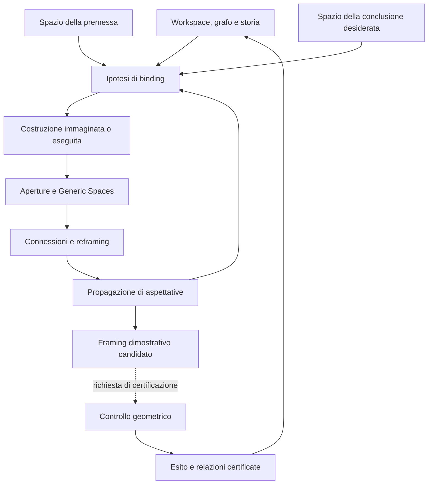

# Merovingio / Panoptikon
## Fondamenti: processo cognitivo, costruzione e certificazione

**Versione:** 0.3 — 12 ottobre 2026  
**Stato:** proposta di architettura cognitiva e annotazione; meccanismi probabilistici ancora da progettare, nessuna esecuzione Jev attestata.  
**Caso iniziale:** Euclide I.10, con I.9 come risorsa costruttiva e I.4 come possibile chiusura dimostrativa.

Questa revisione riformula il nucleo cognitivo della [v0.2](Merovingio_Panoptikon_Fondamenti_v0_2.md), in particolare il §7.4. Il processo è guidato dal significato che elementi, raggruppamenti e corrispondenze acquistano nel workspace rispetto alla relazione desiderata. La storia costruttiva e il grafo visibile sono parte del ragionamento. La certificazione geometrica ha un ruolo distinto: stabilisce quali relazioni possono essere registrate come dimostrate.

La [fixture v0.3](../tests/fixtures/Merovingio_I10_CognitiveProcess_Fixture_v0_3.yaml) accompagna questa specifica. I materiali v0.2 restano disponibili come versione storica. Il nuovo schema descrive un processo da sviluppare; non modifica il reasoner eseguibile presente nel repository.

## 1. Obiettivo: convergenza della percezione verso una relazione

Il Merovingio deve poter attribuire plausibilità a una via costruttiva mentre il suo significato emerge. Gli spazi iniziali possono organizzarsi attorno alle premesse e alla conclusione cercata; costruzioni e binding rendono progressivamente possibili connessioni fra essi. La conclusione è presente fin dall'inizio come **desiderio organizzatore**: dividere AB in parti uguali.

Nel caso I.10 lo spazio della premessa comprende la disponibilità dello schema di bisezione angolare e la configurazione equilatera già costruita. Lo spazio della conclusione riguarda la divisione uguale di AB. Lo schema della bisettrice è una risorsa ricordata da istanziare; in W1 non esiste ancora una bisettrice locale. Stabilire dove istanziarlo è già un atto cognitivo.

Gli obiettivi prioritari sono:

1. **Binding percettivo e relazionale:** proporre e rivedere corrispondenze tra ruoli degli spazi mentali ed elementi della costruzione.
2. **Apertura delle Gestalt:** rendere accessibili parti, ruoli e relazioni quando diventano significativi rispetto al goal.
3. **Formazione di Generic Spaces:** collegare, ricombinare o disassemblare raggruppamenti, conservando la loro genealogia.
4. **Propagazione cognitiva:** far circolare aspettative di uguaglianza e corrispondenza attraverso questi collegamenti prima della prova completa.
5. **Cognitive soundness:** rappresentare quanto una configurazione appare coerente e promettente rispetto alla relazione cercata, con alternative ancora aperte.
6. **Certificazione separata:** sottoporre una relazione e il relativo framing a controllo geometrico quando si vuole registrare una dimostrazione.

La significatività di un elemento può precedere la conoscenza della sua necessità o utilità dimostrativa. Una scelta iniziale non richiede il calcolo deterministico dell'intero albero di prova. Il controllo rimane vincolante per usare la parola «dimostrato», ma non costituisce il motore principale della scelta cognitiva.

## 2. Ontologia cognitiva: bolle probabilistiche che si aprono

I termini sono definizioni operative del progetto. «Bolla probabilistica» indica un pacchetto di raggruppamenti, ruoli e aspettative suscettibile di revisione; la sua rappresentazione matematica è ancora aperta.

| Entità | Ruolo nella v0.3 |
|---|---|
| Gestalt | Organizzazione inizialmente compatta che può aprirsi in parti e relazioni pertinenti. |
| Gestalt Space | Repertorio di aperture, trasformazioni e modi di organizzare una Gestalt, arricchito dalla storia dei workspace. |
| Mental Space | Raggruppamento situato, per esempio lo spazio della premessa o della conclusione, con oggetti, ruoli e aspettative. |
| Generic Space | Pacchetto relazionale che emerge dall'interazione e dall'allineamento di spazi; può avere realizzazioni locali, collegarle e favorire nuove interpretazioni. |
| Frame | Organizzazione di ruoli applicabile a un workspace: bisezione, opposizione angolo–lato, triangolo, coppia di triangoli, SAS. La disponibilità di un Frame non ne impone l'attivazione. |
| Role binding | Ipotesi di matching fra ruoli e oggetti; può essere parziale, concorrente e rivedibile. |
| Workspace | Configurazione con grafo, disposizione, costruzioni compiute e proposte, genealogie e stato cognitivo corrente. |
| Panoptikon | Atlante di workspace e organizzazioni richiamabili per analogia, opposizione, generazione comune e reframing. |

I due raggruppamenti laterali possono essere registrati come realizzazioni locali di un Generic Space e, a loro volta, come membri di un pacchetto che li comprende entrambi. Occorre conservare sia i membri concreti sia la relazione generica e la loro origine. Il vocabolario non deve cancellare passaggi cognitivi perché non hanno ancora una forma astratta definitiva.

La stessa entità può appartenere a più bolle. Un'apertura può esporre una coppia angolo–lato; una ricombinazione può collegare coppie prima separate; un disassemblaggio può sciogliere un'associazione che perde pertinenza. Le operazioni e i loro pesi saranno definiti successivamente.

Le bolle che condividono CD o lo stesso evento generatore sono dipendenti. Più raggruppamenti derivati da una sola linea non costituiscono automaticamente evidenze statistiche indipendenti. La v0.3 non assegna probabilità numeriche né prescrive moltiplicazioni o normalizzazioni di punteggi. Le probabilità eventualmente prodotte da Jev su opzioni locali non sono, da sole, una teoria delle bolle.

## 3. Tre registri collegati nel workspace

### 3.1 Costruzione e percezione

Conservare il grafo, incidenza, ordine, opposizione angolo–lato, carrier condivisi, disposizione relativa e storia costruttiva. In particolare: `incident`, `between`, `collinear`, `orient`, `cyclic_order`, `constructed_from`.

Distinguere `Line(A,B)`, `Ray(A,B)`, `Segment(A,B)` e angoli tra raggi. Per il bridge iniziale da C l'orientamento della futura linea può restare aperto: lo schema di bisezione determina una semiretta, e l'intersezione con AB determina D.

La disponibilità del grafo e delle costruzioni già svolte è legittima informazione cognitiva. Si può anticipare una configurazione futura mantenendone esplicito il carattere immaginato. Dopo averla costruita, la sua struttura diventa disponibile per ulteriori raggruppamenti. Il sistema registra questi passaggi, senza dover dimenticare ciò che ha visto o prodotto.

### 3.2 Interpretazioni e aspettative

Una relazione può essere desiderata, anticipata, percepita come plausibile o rafforzata da un nuovo raggruppamento. Il suo peso cognitivo e il suo stato formale sono campi distinti.

Per esempio `AD=DB` è inizialmente un goal, può poi essere un'aspettativa forte e infine una conclusione certificata. Lo stesso vale per il ruolo di punto medio. Gli angoli in D possono suggerire una perpendicolarità prima che questa sia dimostrata.

Il role binding registra almeno: spazio di origine, ruoli proposti, oggetti o variabili bersaglio, ragioni percettive, richiami a workspace precedenti quando disponibili, alternative, tempo e stato della proposta. I richiami effettivi devono avere una provenienza; un richiamo soltanto ipotizzato non va presentato come memoria già recuperata.

### 3.3 Relazioni certificate

Le premesse geometriche e le conseguenze verificate mantengono una provenienza distinta. Il verificatore controlla costruzione, corrispondenza, premesse e dipendenze della prova quando viene richiesta una certificazione. Un esito può rientrare nel processo cognitivo come nuova informazione, senza riscrivere retroattivamente le ragioni delle scelte precedenti.

La ricorrenza di un'aspettativa nel processo cognitivo non coincide con la circolarità logica di una prova. Desiderare AD=DB e farne crescere la plausibilità è legittimo; usarla come premessa della stessa dimostrazione non fornisce un certificato valido.

### 3.4 Salienza e potenziale del bridge

`ObjectSalience` riguarda la significatività attuale di un elemento. `BridgePotential` riguarda quali organizzazioni una costruzione potrebbe aprire e connettere verso il goal. Entrambi possono dipendere da disposizione, opposizioni, memoria, generazione comune e aspettative emergenti.

Il Frame dimostrativo finale può essere ancora aperto. Non occorre conoscere tutti gli slot di SAS per attribuire priorità al vertice opposto ad AB. Costi di prova e controlli formali potranno essere segnali aggiuntivi in esperimenti dedicati; non definiscono da soli il valore cognitivo del bridge.

## 4. Euclide I.9: da un angolo a una bisettrice attraverso I.8

### 4.1 Problema ed esattezza storica

**Obiettivo:** bisecare l'angolo dato `BAC`.

**Notazione standard della costruzione:**

1. Scegliere `D` su `AB`.
2. Su `AC` scegliere `E` in modo che **AD = AE** (I.3).
3. Congiungere `D` ed `E`.
4. Costruire un triangolo equilatero **DEF** sulla base `DE`, scegliendo `F` sul lato opposto ad `A` rispetto alla retta `DE` (I.1).
5. Congiungere `A` ed `F`.

Schema topologico *illustrativo*, non in scala:

```text
               A
              / \
             /   \
            D-----E       D∈AB, E∈AC, AD=AE
           / \   / \
          /   \ /   \
         B     F     C    DEF equilatero sul lato lontano da A

            A——F è il segmento che biseca ∠BAC
```

La figura sopra segnala gli oggetti ma non rappresenta proporzioni o prolungamenti con precisione; il dato verificabile è la lista di incidenza/ordine e le condizioni sulla scelta di `F`.

### 4.2 Dimostrazione rigorosa e Frame

Consideriamo i **due triangoli ADF e AEF**:

- `AD = AE` (costruzione sui due raggi);
- `DF = EF` (equilatero `DEF`);
- `AF = AF` (identità del segmento condiviso).

Si soddisfa **I.8 = LLL / SSS**, non I.4:

\[
(AD=AE)\land(DF=EF)\land(AF=AF)
\xRightarrow{\mathrm{I.8}}
\angle DAF=\angle FAE.
\]

Poiché `AD` e `AB` sono lo stesso raggio da `A`, così come `AE` e `AC`, la retta `AF` biseca `∠BAC`.

**Errore da evitare:** I.9 non usa I.4/LAL nella dimostrazione principale. Non richiede il punto di intersezione fra `AF` e `DE`. Se aggiungiamo un punto `O = AF ∩ DE` per l'analisi cognitiva o il rendering, è un **oggetto esteso del nostro workspace**, non un passo dell'originale I.9. Non dobbiamo trattarlo come punto medio o piede della perpendicolare senza una dimostrazione ulteriore.

### 4.3 Lettura cognitiva

La costruzione di I.9 mette in relazione lo spazio dell'angolo e quello dell'equilatero ausiliario. Il collegamento AF produce regioni e corrispondenze riusabili. La spiegazione geometrica precedente documenta la certificazione di questo caso; una traccia cognitiva deve conservare anche come AF ha acquistato significato e quali raggruppamenti ha reso salienti.

## 5. Euclide I.10: da bisettrice a punto medio attraverso I.4

### 5.1 Problema e costruzione

**Obiettivo:** dividere un segmento dato `AB` in due parti uguali.

1. Costruire il triangolo equilatero **ABC** sulla base `AB` (I.1).
2. Bisecare `∠ACB` con la semiretta `CD` costruita usando **I.9**.
3. `D` è il punto in cui la bisettrice `CD` incontra `AB` (nel suo interno).

Schema orientativo:

```text
                   C
                  /|\
                 / | \
                /  |  \
               /   |   \
              A----D----B

      triangoli: ACD (sinistra), BCD (destra)
      D si trova su AB e C–D è comune ai due
```

### 5.2 Passaggio dimostrativo

Nel Frame `(ACD, BCD)`:

- **AC = BC** perché `ABC` è equilatero;
- **∠ACD = ∠DCB** grazie alla costruzione della bisettrice mediante I.9;
- **CD = CD** poiché è lo stesso segmento per entrambi i triangoli.

Gli angoli uguali sono *compresi* fra le coppie di lati corrispondenti. Si istanzia quindi **I.4 = LAL / SAS**:

\[
(AC=BC)\land(\angle ACD=\angle DCB)\land(CD=CD)
\xRightarrow{\mathrm{I.4}}
AD=DB.
\]

Essendo `A-D-B`, `D` è punto medio di `AB`. La perpendicolarità `CD ⟂ AB` può essere ricavata *successivamente* combinando l'uguaglianza degli angoli adiacenti in `D` con il fatto che formano un angolo piatto, ma **non è premessa della prova di I.10**.

### 5.3 Perché il vertice opposto alla base può diventare prioritario

AB è il carrier della conclusione desiderata. Lo schema ricordato di bisezione cerca un angolo sul quale istanziarsi. Nel triangolo ABC, ∠ACB è l'angolo opposto ad AB: questa relazione offre un binding percettivamente significativo tra lo spazio angolare della premessa e quello metrico della conclusione.

L'opposizione angolo–lato può richiamare organizzazioni presenti in workspace precedenti. È un motivo per assegnare priorità a C nella proposta cognitiva; quanto Jev effettivamente lo privilegi dovrà essere osservato. Il nome C non deve diventare una regola incorporata: il binding va seguito anche rinominando punti e cambiando orientamento.

Le alternative su A e B restano confrontabili. Cambiando il segmento-obiettivo, cambiano anche le opposizioni pertinenti. La preferenza per C deve essere sensibile a questa organizzazione, non soltanto all'immagine stereotipata del vertice «in alto».

### 5.4 Dalla partizione alla plausibilità della divisione uguale

La linea istanziata da C partisce l'angolo e il triangolo. La successione seguente è una traccia illustrativa dei raggruppamenti da poter registrare, non una sequenza obbligatoria né un risultato osservato di Jev.

| Passaggio | Pacchetto che si apre | Membri e significato |
|---|---|---|
| 1. Parte sinistra | `GS_LEFT` | ∠ACD, ∠CAD, ∠ADC; AC, AD, CD e D: mezza apertura al vertice, angolo laterale e angolo all'intersezione. |
| 2. Parte destra | `GS_RIGHT` | ∠DCB, ∠CBD, ∠CDB; BC, DB, CD e D: organizzazione corrispondente sull'altro lato. |
| 3. Reframing triangolare | `GS_TRIANGLE_PAIR` | I gruppi si riconoscono come ACD e BCD; il framing espone relazioni interne prima compresse. |
| 4. Origine comune | `GS_COMMON_GENERATOR` | I due gruppi appartengono a un unico pacchetto perché prodotti dalla stessa linea in ABC, con CD e D condivisi. Questo legame può emergere anche prima del reframing triangolare. |
| 5. Opposizioni locali | `GS_OPPOSITE_LEFT`, `GS_OPPOSITE_RIGHT` | Nel primo triangolo ∠ACD ↔ AD, ∠CAD ↔ CD, ∠ADC ↔ AC; nel secondo ∠DCB ↔ DB, ∠CBD ↔ CD, ∠CDB ↔ BC. |
| 6. Accoppiamenti trasversali | `GS_ANGLE_PAIRS`, `GS_SIDE_PAIRS` | Coppie di angoli e coppie di lati tra i due gruppi, con uguaglianze note, ipotizzate o ancora aperte esplicitamente distinte. |
| 7. Collegamento al goal | `GS_ANGLE_TO_BASE` | La coppia di angoli al vertice si collega alla coppia AD, DB attraverso le opposizioni locali e l'organizzazione comune. |

La congruenza degli angoli della bisettrice entra inizialmente nello spazio angolare bindato. I collegamenti consentono che la sua rilevanza raggiunga le parti della base: «questa uguaglianza potrebbe manifestarsi anche nei lati opposti dei due gruppi». È **propagazione di plausibilità** e di significato, da conservare come evento cognitivo prima della prova.

La regolarità dell'equilatero e l'origine comune rafforzano l'aspettativa di corrispondenza. La genealogia condivisa non rende da sola congruenti le due parti di ogni triangolo: il sistema può rivedere l'aspettativa quando cambia il contesto. In D si generano due angoli adiacenti; l'interpretazione di essi come retti può essere un'anticipazione saliente, con stato formale ancora aperto.

### 5.5 SAS come framing conclusivo e certificazione

Quando le corrispondenze si organizzano nei due triangoli, SAS può diventare una via particolarmente diretta e plausibile. Riconoscere questa configurazione è ancora un atto cognitivo; verificare formalmente I.4 è un passaggio distinto. Il contenuto matematico è quello del §5.2: AC=BC, ∠ACD=∠DCB e CD=CD consentono di concludere AD=DB.

La prova certifica la relazione anticipata. Se il controllo fallisce, l'anticipazione resta documentata come tale e può essere riorganizzata. La v0.3 attribuisce priorità di ricerca alla formazione dell'anticipazione e alla sua genealogia.

## 6. Protocollo cognitivo e controllo geometrico

Il ciclo proposto è:

`FOCUS → PROPOSE_BINDING → INSTANTIATE / IMAGINE → OPEN_GROUPINGS → CONNECT / REFRAME → PROPAGATE_EXPECTATIONS → REVISE`

Le frecce indicano dipendenze illustrative. I passaggi possono ripetersi, coesistere e riaprire organizzazioni precedenti. La procedura con cui Jev e gli altri componenti realizzano ciascun passaggio resta da progettare.



Jev partecipa alle scelte probabilistiche su binding, aperture, collegamenti e reframing. Il supporto alla costruzione può calcolare intersezioni e aggiornare il grafo; il certificatore verifica le affermazioni formali. Questi calcoli locali non richiedono che sia già stato risolto l'intero albero della dimostrazione prima di scegliere la costruzione.

Una traccia deve distinguere **PROPAGATE_EXPECTATIONS**, che può precedere la prova, da **RECORD_CERTIFIED_RELATIONS**, che ne richiede l'esito. La registrazione dei Generic Spaces continua anche quando manca un certificato.

## 7. Istanziazione e apertura progressiva nel caso I.10

### 7.1 Spazi iniziali e domanda di binding

Lo spazio della premessa contiene il repertorio della bisezione angolare. Lo spazio della conclusione contiene AB e la divisione uguale desiderata. ABC, già costruito, offre il contesto comune. La prima domanda è: **dove lo schema di bisezione acquista maggior significato rispetto ad AB?**

L'ipotesi di binding su ∠ACB collega l'opposizione angolo–lato al goal. Una successiva domanda riguarda come istanziare la linea affinché la partizione angolare incontri il carrier della conclusione. Il Frame dimostrativo finale può rimanere indefinito in entrambe le scelte.

### 7.2 Storia disponibile e anticipazione

| Configurazione | Organizzazione cognitiva possibile | Stato della certificazione |
|---|---|---|
| W1: ABC su AB | Separazione premessa/goal; ipotesi di binding su C; anticipazione di linea e raggruppamenti | Sono disponibili le relazioni dell'equilatero; D è una variabile prospettica. |
| W1 con costruzione immaginata | Apertura virtuale delle due parti e confronto con altre istanziazioni | La simulazione non aggiorna automaticamente i fatti della costruzione reale. |
| W2: bisettrice costruita e D su AB | Storia e grafo aggiornati; aperture, triangoli, origine comune, opposizioni e aspettativa AD=DB | L'uguaglianza angolare può avere provenienza I.9; AD=DB è ancora da certificare. |
| W2 con aspettativa rafforzata | Cognitive soundness della divisione uguale; possibile attivazione di SAS | Il framing SAS proposto non è ancora il risultato del controllo. |
| W3: certificazione di I.4 | Stabilizzazione e memoria del percorso, con possibilità di ulteriori aperture | AD=DB è certificato; il ruolo di punto medio segue con A-D-B. |

I passaggi cognitivi possono essere anticipati o riordinati: vanno marcati come immaginati, realizzati o rivisti. Si conserva tutta l'informazione costruttiva disponibile a quel momento. Una traccia di riferimento completata dall'autore non va passata integralmente al modello fingendo che sia lo stato iniziale.

### 7.3 Alternative cognitive e giudizi formali

Bisecare in C, in A o in B produce binding con relazioni diverse rispetto ad AB. Congiungere C a un punto della base può produrre raggruppamenti significativi anche prima che sia individuata una proprietà metrica. Questi confronti riguardano organizzazione e plausibilità.

La v0.2 etichettava il piano LLL come `reject_circular` e quello del punto arbitrario come `incomplete_frame`. Tali diagnosi riguardano la certificazione con quelle premesse e non devono essere la spiegazione precalcolata della prima scelta di Jev. Un'aspettativa AD=DB può partecipare a un pacchetto cognitivo LLL; un certificato che la assuma per dimostrare se stessa fallisce. I due giudizi appartengono a registri differenti.

### 7.4 Schema del binding e della linea da istanziare

L'unità iniziale è un'**ipotesi di istanziazione** con obiettivo e motivazione cognitiva. L'esempio seguente espone l'ipotesi su C per renderla discutibile; non dichiara una scelta già compiuta da Jev. `target_instantiation_line` identifica la linea prospettica, il luogo verso cui si dirige e il senso dell'istanziazione, senza fissare già D come punto medio.

```yaml
candidate_id: BIND_BISECTOR_AT_C
at_state: W1
status: matching_hypothesis
source_mental_space: MS_PREMISE_BISECTION
target_mental_space: MS_GOAL_BASE
frame_to_instantiate: ANGLE_BISECTION
instantiation_objective: connect_angular_partition_to_desired_base_partition
role_mapping_hypothesis:
  angle_to_partition: ACB
  angle_vertex: C
  rays: [CA, CB]
  opposite_goal_carrier: AB
target_instantiation_line:
  status: proposed
  source_vertex: C
  host_angle: ACB
  target_carrier: AB
  orientation_hypothesis: internal_angle_bisection
  proposed_ray: ray_CD
  intersection_variable: D
  resulting_segment_if_realized: CD
  objective: let_one_partition_connect_angle_and_base_spaces
  endpoint_metric_role: open
cognitive_cues:
  - opposition_between_bound_angle_and_goal_side
  - potential_for_coupled_groupings_from_one_generator
  - prior_opposition_bindings_if_retrieved
memory_evidence_refs: []
probability: null
final_demonstrative_frame: null
```

`probability: null` significa non misurata. `final_demonstrative_frame: null` rende esplicito che la proposta non deve arrivare con SAS e una prova completa già incorporati. `memory_evidence_refs` vuoto non attesta il recupero di esempi storici. Il futuro schema operativo dovrà rappresentare anche revisioni, disassemblaggi e dipendenze fra bolle; qui non ne fissiamo l'algoritmo.

La fixture distingue l'input cognitivo dai riferimenti per l'autore: il primo contiene W1 e alternative aperte; i secondi descrivono una possibile progressione e una certificazione attesa. Il codice futuro dovrà costruire l'input di ciascun passo a partire dagli eventi realmente disponibili in quel momento.

### 7.5 Che cosa sceglierebbe Jev, e perché

1. **Binding:** quanto è significativo associare la bisezione a ∠ACB rispetto al goal su AB, alle alternative e ai richiami disponibili?
2. **Istanziazione:** quale linea rende quel binding percepibile e connette i due spazi?
3. **Apertura:** quali raggruppamenti diventano salienti dopo la linea, e quali parti di una Gestalt conviene esporre?
4. **Connessione e reframing:** come collegare i gruppi locali, riconoscerli come triangoli e conservarne la comune origine?
5. **Propagazione:** quanto si rafforza l'aspettativa di uguaglianza dei lati opposti quando gli angoli uguali e i lati-obiettivo si trovano nello stesso sistema di corrispondenze?
6. **Framing conclusivo:** quando SAS diventa una lettura diretta della configurazione e merita una richiesta di certificazione?

Queste domande esplicitano l'ipotesi architetturale. Non sappiamo ancora se Jev le realizzi efficacemente né come misurare e aggiornare i pesi delle bolle. Il punto da verificare è la formazione progressiva di significato, includendo fallimenti, ritorni e alternative.

### 7.6 Esperimento cognitivo da progettare

Registrare separatamente il momento della scelta del binding, l'apertura di ogni raggruppamento, le revisioni, l'aspettativa sul goal e l'eventuale richiesta di certificazione. Misurare il cambiamento di priorità quando si aggiungono opposizione angolo–lato, storia costruttiva e origine comune.

Confronti utili: stessa figura con diversa storia; punti rinominati o figura ruotata; diverso lato-obiettivo; triangolo non equilatero; linea generata arbitrariamente; accesso o meno a workspace precedenti. Servono a verificare sensibilità al contesto e dipendenza effettiva dagli spazi, evitando di attribuire valore a una spiegazione scritta a posteriori.

Le metriche cognitive riguardano binding, copertura della genealogia dei raggruppamenti, revisione delle aspettative e transfer. Esito e costo della prova sono misure distinte, utilizzabili per valutare dove il processo conduce. Un benchmark di certificazione può restare disponibile senza costituire l'oracolo della scelta iniziale.

## 8. Jev come componente della proposta

Il compito assegnato a Jev riguarda priorità probabilistiche su elementi e organizzazioni presentati dal workspace. La distinzione visivo/cognitivo deve essere preservata anche quando la disposizione viene codificata come struttura: opposizione, incidenza, partizione e genealogia devono essere accessibili al componente che sceglie il binding.

La v0.3 non definisce un nuovo formato di richiesta API né attribuisce a Jev capacità già dimostrate di percepire immagini, mantenere bolle persistenti o apprendere dai workspace. I dettagli API raccolti nella [v0.2, §8](Merovingio_Panoptikon_Fondamenti_v0_2.md#8-jev-perché-può-essere-utile-e-che-cosa-consente-davvero-lapi) sono una nota storica datata 11 ottobre 2026; vanno verificati quando si implementerà l'integrazione.

Memoria, serializzazione delle alternative, evoluzione dello stato e registrazione della genealogia sono responsabilità architetturali da specificare. Nessuna confidence API va interpretata automaticamente come probabilità che una proposizione sia vera o come misura già validata della cognitive soundness.

## 9. Dati e valutazione

Ogni episodio dovrebbe conservare:

- configurazione, goal e storia realmente disponibili al momento;
- spazio-premessa e spazio-conclusione, con binding concorrenti;
- costruzioni immaginate ed eseguite, distinte;
- aperture, membri dei pacchetti, relazioni generiche, generatori e revisioni;
- aspettative prima e dopo i collegamenti, con punteggi solo se effettivamente prodotti;
- frame conclusivi proposti e, separatamente, richieste ed esiti di certificazione.

Le annotazioni d'autore, gli esiti attesi e le future fasi dell'episodio servono alla valutazione; non sono osservazioni iniziali del modello. Il goal è invece visibile fin dall'inizio, come relazione desiderata. Disegno, grafo e storia della costruzione corrente restano parte dell'input.

Le prove I.9 e I.10 forniscono casi controllati per distinguere traccia cognitiva e certificato. Nuovi workspace e variazioni del goal permetteranno di valutare se il meccanismo generalizza oltre la riproduzione dell'esempio. La fixture allegata è una specifica illustrativa, non un esperimento eseguito.

## 10. Criteri di qualità della traccia

1. Conservare ogni passaggio significativo di apertura e collegamento, compresi quelli che non conducono a una prova.
2. Distinguere ricostruzione d'autore, anticipazione e evento osservato; non presentare una traccia esplicativa come accesso agli stati interni effettivi di Jev.
3. Mantenere separati peso cognitivo, stato della costruzione e stato formale.
4. Consentire corrispondenze parziali e aspettative concorrenti; registrarne revisione e disassemblaggio.
5. Conservare la dipendenza dei gruppi dal loro generatore comune, evitando di contarli come conferme indipendenti.
6. Usare i controlli di circolarità e validità quando si richiede un certificato, senza riscrivere la scelta iniziale come eliminazione formale precalcolata.
7. Valutare la cognitive soundness anche nei casi in cui un'aspettativa plausibile si rivela sbagliata.

## 11. Questioni aperte

Restano da progettare la rappresentazione probabilistica delle bolle, i criteri di apertura e disassemblaggio, il recupero di analogie fra workspace, l'aggiornamento delle dipendenze e il passaggio dalla percezione di una configurazione alla proposta di un framing dimostrativo.

Il prossimo lavoro concettuale può partire dal confronto fra più tracce di binding nello stesso workspace. L'obiettivo è specificare quali cambiamenti di organizzazione fanno aumentare o diminuire la plausibilità percepita, senza assumere che una lista di controlli formali abbia già spiegato il processo.

## Changelog v0.3

- Processo cognitivo centrale: spazi di premessa e conclusione, binding, apertura delle Gestalt, Generic Spaces e propagazione di aspettative.
- §7.4 riscritto con `target_instantiation_line`, obiettivo di istanziazione, role mapping ipotetico e framing dimostrativo ancora aperto.
- Genealogia esplicita dei due gruppi, reframing triangolare, generatore comune, opposizioni locali e coppie trasversali.
- SAS distinto come framing conclusivo e come successivo certificato geometrico.
- Traccia illustrativa, input cognitivo e riferimento di certificazione separati nella fixture v0.3; versioni v0.2 conservate.

## Provenienza e riferimenti

La formulazione cognitiva v0.3 deriva dalla revisione del progetto del 12 ottobre 2026. È un'ipotesi architetturale, non un'affermazione sperimentalmente validata sul funzionamento della mente o di Jev.

I §§4.1–4.2 e 5.1–5.2 conservano il riferimento geometrico della [v0.2](Merovingio_Panoptikon_Fondamenti_v0_2.md), con la bibliografia lì riportata. La presente revisione riguarda la separazione e l'ordine dei processi cognitivi e dimostrativi; non aggiorna la ricerca bibliografica o la documentazione del servizio Jev.
